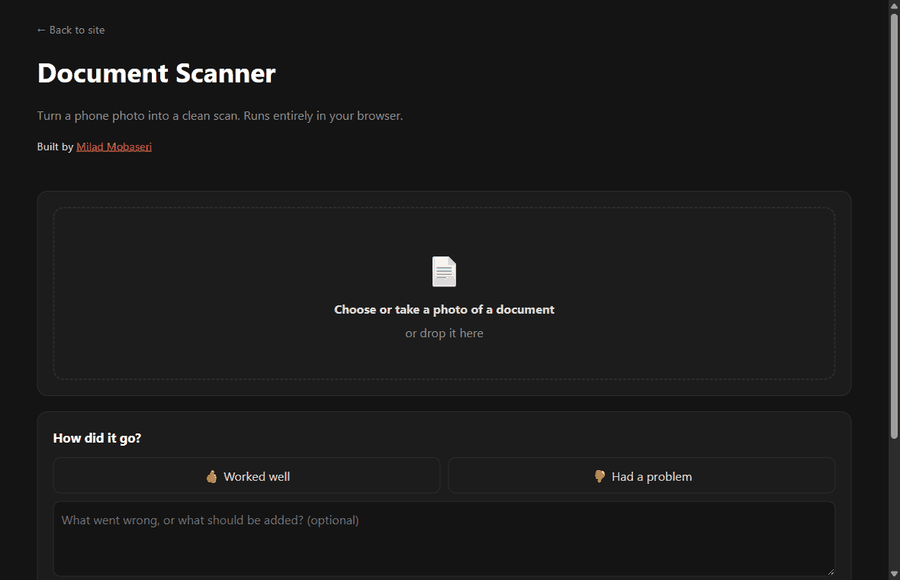
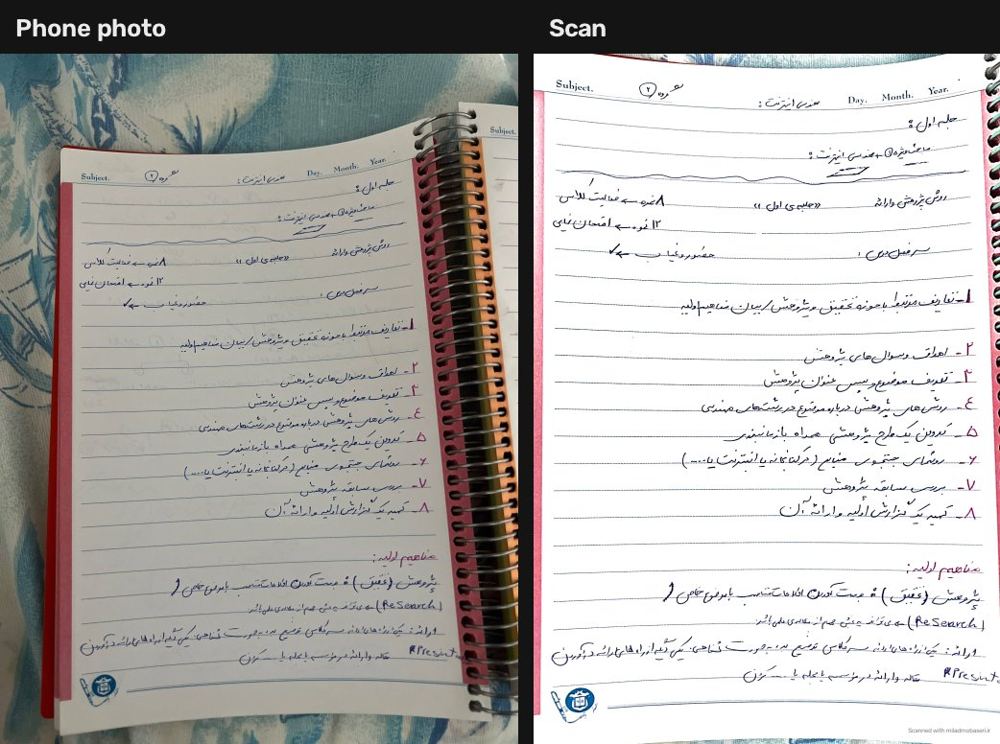
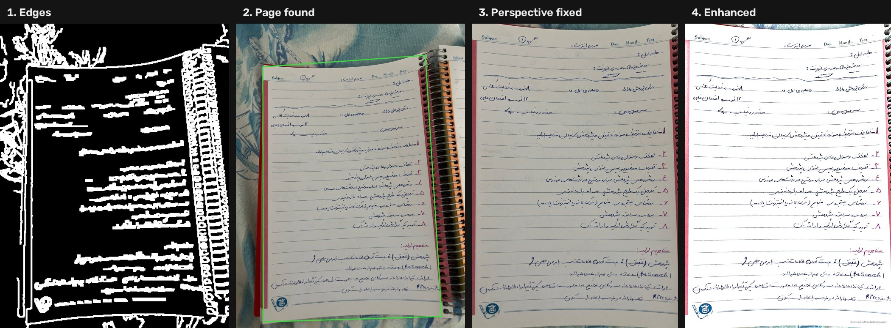
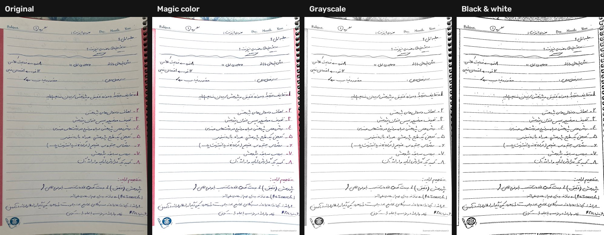

<div align="center">

# اسکنر اسناد · Document Scanner

**عکس گوشی از یک برگه را به یک اسکن صاف و تمیز تبدیل می‌کند، کاملاً داخل مرورگر**
کراپ خودکار · اصلاح پرسپکتیو · حذف سایه · خروجی PDF · بدون آپلود عکس

[](https://github.com/Milad1098/image-processing-projects/actions/workflows/tests.yml)
[](https://miladmobaseri.ir/en/tools/scanner)


[](../LICENSE)

[**امتحانش کن**](https://miladmobaseri.ir/fa/tools/scanner) · [English](#english) · [Case study](docs/CASE-STUDY.md)



</div>

<p align="center">
  
</p>

<div dir="rtl">

## امکانات

- **کراپ خودکار**: برگه را پیدا می‌کند، حتی برگه‌ی دفتر سیمی، صفحه‌ی خمیده یا برگه‌ای که از کادر عکس بیرون زده
- **اصلاح پرسپکتیو**: عکسِ کج گرفته‌شده را به یک مستطیل صاف تبدیل می‌کند
- **تنظیم دستی**: گوشه‌ها با موس یا انگشت کشیدنی‌اند
- **چرخش خودکار**: برگه‌ی خوابیده را از جهت سطرهای متن تشخیص می‌دهد؛ دکمه‌ی چرخش هم دارد
- **۴ فیلتر**: رنگی (Magic color)، خاکستری، سیاه‌وسفید، اصلی
- **کیفیت بهتر**: حذف سایه، سفید کردن کاغذ، شارپ کردن، حذف لکه‌های ریز
- **PDF چندصفحه‌ای**
- **فارسی و انگلیسی**، راست‌به‌چپ، سازگار با موبایل

## حریم خصوصی

همه‌ی پردازش روی دستگاه خود کاربر انجام می‌شود (Python و OpenCV که با Pyodide به WebAssembly کامپایل شده‌اند). **عکس هیچ‌وقت آپلود نمی‌شود** و سرور فقط چند فایل استاتیک تحویل می‌دهد.

## داستان ساخت

نسخه‌ی اول روی عکس‌های واقعی شکست خورد: گل‌های رومیزی به لبه‌ی برگه چسبیده بودند، فیلتر رنگی دور متن هاله می‌انداخت و برگه‌ی دفتر سیمی اصلاً پیدا نمی‌شد. هر شکست، علتش و راه‌حلش در [**Case study**](docs/CASE-STUDY.md) با جزئیات آمده است.

</div>

---

<a name="english"></a>
## English

A CamScanner-style document scanner built with classic computer vision, no machine-learning model.
It runs **entirely in the browser**: the same Python/OpenCV code is executed by [Pyodide](https://pyodide.org) (WebAssembly), so photos never leave the device and the server only hosts static files.

**[Try it live →](https://miladmobaseri.ir/en/tools/scanner)**

### How it works

<p align="center"></p>

| Step | Technique | Module |
|------|-----------|--------|
| Find the page | Canny edges → contours → largest 4-sided shape; fallback: bright, low-saturation region (HSV) → convex hull → 4 corners, with a fill-ratio sanity check | [`detect.py`](scanner/detect.py) |
| Flatten | `getPerspectiveTransform` + `warpPerspective`, border trim | [`detect.py`](scanner/detect.py) |
| Upright | Row vs. column ink profiles: text lines make the profile across them alternate | [`orient.py`](scanner/orient.py) |
| Remove shadows | Background = morphological closing (ink erased) → divide it out | [`enhance.py`](scanner/enhance.py) |
| Clean up | Unsharp mask, levels (paper → pure white), adaptive threshold, connected-component speck filter | [`enhance.py`](scanner/enhance.py) |
| Credit & export | Watermark on every page, multi-page PDF with author metadata | [`watermark.py`](scanner/watermark.py), [`export.py`](scanner/export.py) |

<p align="center"></p>

**Read more:** [Case study](docs/CASE-STUDY.md) · [Architecture](docs/ARCHITECTURE.md) · [Design decisions](docs/DECISIONS.md) · [Roadmap](docs/ROADMAP.md)

### Project structure

```
scanner/          the algorithm: pure Python + OpenCV, no UI code
  detect.py       find page corners (edges, then paper color), perspective crop
  orient.py       sideways-page detection, rotation
  enhance.py      filters: magic color / grayscale / black & white / original
  watermark.py    creator credit on exported pages
  export.py       multi-page PDF
  pipeline.py     scan() = automatic decisions, render() = apply the user's edits
  __main__.py     command-line interface
web/              browser app (static files)
  index.html, style.css, app.js   UI: drag corners, filters, pages, feedback
  bridge.py       JS ⇄ Python glue, runs inside Pyodide
  publish.py      copies the app into the website's static folder
app.py            Gradio UI for local experiments
tests/            self-check on synthetic photos (no test framework needed)
docs/             case study, architecture, decisions, figures
```

### Run locally

Requires Python 3.10+.

```bash
python -m venv .venv
.venv\Scripts\activate            # macOS/Linux: source .venv/bin/activate
pip install -r requirements.txt

python -m http.server 8000                                  # browser app: http://localhost:8000/web/  (?lang=fa)
python -m scanner photo.jpg --mode bw --pdf scan.pdf        # CLI, images go to output/
python app.py                                               # Gradio UI: http://127.0.0.1:7860
python -m tests.test_pipeline                               # self-check
python docs/make_figures.py photo.jpg                       # regenerate the README figures
```

### Tests

[`tests/test_pipeline.py`](tests/test_pipeline.py) builds synthetic photos with known page corners and checks: corner ordering, detection accuracy (±12 px), page shape recovery, background clutter touching the page, a page cut off by the frame on a colored background, sideways detection, filter outputs (binary B&W, pure-white paper), the no-page fallback and multi-page PDF export. It runs on every push via GitHub Actions.

### Analytics & feedback

`web/app.js` reports anonymous events (`engine_ready`, `photo_scanned`, `filter_changed`, `corners_adjusted`, `page_added`, `downloaded`, `feedback`, `js_error`) to the endpoint set in `window.SCANNER_CONFIG.endpoint`. No image or image data is ever sent. Without an endpoint, events only go to the browser console.

### Known limits

- A 4-corner crop cannot fully flatten a curved page; a thin strip of background can remain at the edges (drag the corners to trim it).
- Auto-rotate tells upright from sideways, not 90° from 270° or upside down; the rotate buttons cover it.
- The page needs some contrast with the surface under it.
- First visit downloads the Python runtime (~10–15 s); later visits are cached.

## License

[MIT](../LICENSE) © Milad Mobaseri
