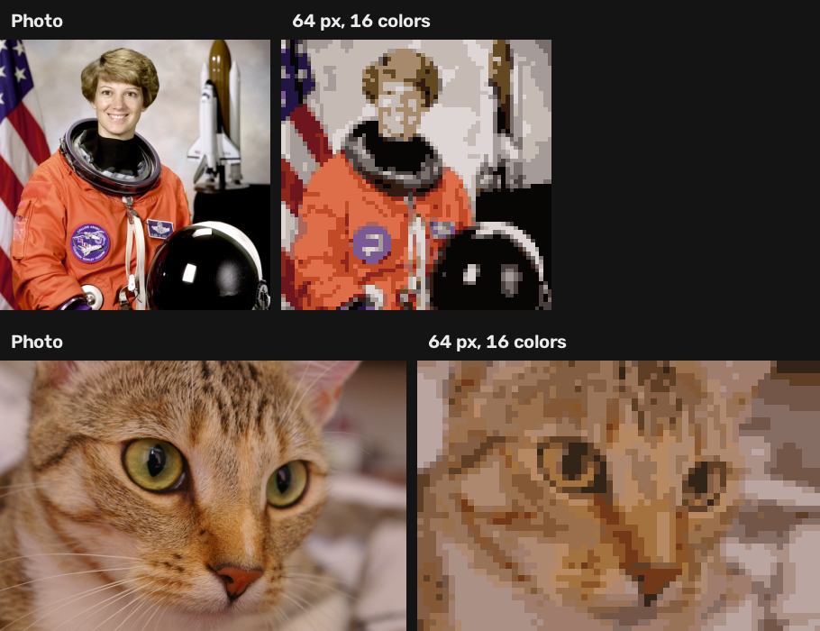
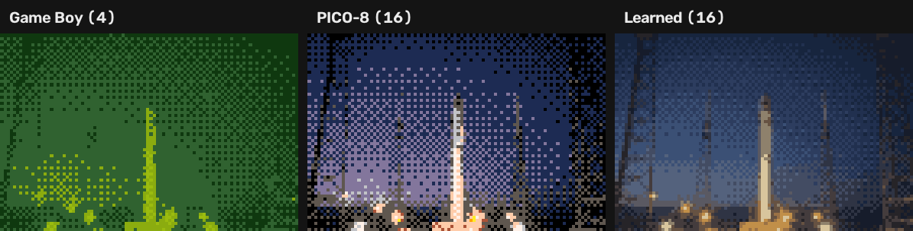

<div align="center">

# ساخت پیکسل‌آرت · Pixel Art Maker

**هر عکسی را به پیکسل‌آرت تبدیل می‌کند، کاملاً داخل مرورگر**
کاهش رنگ ادراکی · دیترینگ · پالت‌های رترو · هر تصمیم با آزمایش و عدد

[](https://github.com/Milad1098/image-processing-projects/actions/workflows/tests.yml)


[](../LICENSE)

[English](#english) · [Case study](docs/CASE-STUDY.md) · [Results](docs/RESULTS.md)



</div>

<div dir="rtl">

## امکانات

- **اندازه‌ی دلخواه**: از ۱۶ تا ۱۶۰ پیکسل در عرض
- **پالت یادگرفته از خود عکس** (۲ تا ۳۲ رنگ) با K-Means که از صفر نوشته شده
- **پالت‌های رترو**: گیم‌بوی، PICO-8، خاکستری؛ با تطبیق روشنایی عکس به پالت
- **دیترینگ**: Floyd–Steinberg (نرم) و Bayer (الگوی رترو)
- **تطبیق رنگ ادراکی** در فضای CIELAB، با امکان مقایسه با RGB
- **سریع**: سنگین‌ترین حالت در مرورگر حدود ۰٫۳ ثانیه
- **فارسی و انگلیسی**، سازگار با موبایل، بدون آپلود عکس

## چه چیزی نسبت به پروژه‌ی قبل پیشرفت کرده

در [اسکنر اسناد](../01-document-scanner/) تصمیم‌ها با دیدن خروجی گرفته می‌شد. اینجا **هر تصمیم با یک آزمایش قابل تکرار** روی تصاویر استاندارد و آزاد گرفته شده و الگوریتم اصلی از صفر پیاده و با نسخه‌ی OpenCV مقایسه شده است. آزمایش‌ها چهار مشکل واقعی پیدا کردند که با نگاه کردن پیدا نمی‌شد؛ همه در [**Case study**](docs/CASE-STUDY.md) با عدد قبل و بعد آمده‌اند.

</div>

---

<a name="english"></a>
## English

Turns any photo into pixel art in the browser: perceptual color reduction, dithering and
retro palettes. The same Python/NumPy code runs in [Pyodide](https://pyodide.org)
(WebAssembly), so photos never leave the device.

**The point of this project is method.** Every design choice is backed by a reproducible
experiment on public-domain images, and the core algorithm (K-Means) is implemented from
scratch and benchmarked against OpenCV. The experiments caught four real problems; the
[case study](docs/CASE-STUDY.md) shows each with numbers before and after.

### Key findings

| Question | Finding | Evidence |
|---|---|---|
| Cluster colors in RGB or CIELAB? | Lab cuts perceptual error by 9–11% and keeps small vivid details that RGB drops | [§1](docs/CASE-STUDY.md#1-rgb-or-cielab-the-blue-patch-that-disappeared) |
| Is the hand-written K-Means as good as OpenCV's? | It was 1–3% worse; greedy k-means++ seeding brought it within 2% | [§2](docs/CASE-STUDY.md#2-my-k-means-was-13-worse-than-opencvs) |
| Does dithering help? | Seen from a distance, Floyd–Steinberg cuts error by up to 19%; a fixed Bayer strength made 16 colors *worse* until it was scaled to the palette | [§3](docs/CASE-STUDY.md#3-bayer-dithering-made-16-color-output-worse) |
| Why did fixed palettes look wrong? | Lightness mismatch; tone fitting raised structure correlation from 0.69 to 0.87 (Game Boy) | [§4](docs/CASE-STUDY.md#4-the-game-boy-palette-turned-photos-into-green-mush) |
| Can it be fast in the browser? | Wavefront-vectorized Floyd–Steinberg (identical output, 11×) + palette sampling: 4.7 s → 0.33 s | [§5](docs/CASE-STUDY.md#5-47-seconds-per-click-in-the-browser) |

<p align="center"></p>

<p align="center"></p>

**Read more:** [Case study](docs/CASE-STUDY.md) · [All results](docs/RESULTS.md) · [Architecture](docs/ARCHITECTURE.md) · [Design decisions](docs/DECISIONS.md) · [Roadmap](docs/ROADMAP.md)

### Project structure

```
pixelart/          the algorithm: NumPy + OpenCV, no UI code
  color.py         sRGB ⇄ CIELAB (D65), ΔE
  quantize.py      K-Means from scratch (greedy k-means++), palette learning and mapping, tone fitting
  dither.py        Floyd–Steinberg (wavefront-vectorized) and Bayer dithering
  palettes.py      Game Boy, PICO-8, grayscale
  pipeline.py      downscale → palette → map/dither; upscale for display
  __main__.py      command-line interface
experiments/run.py every experiment behind the decisions → docs/RESULTS.md
web/               browser app (static files, Pyodide)
tests/             reference values, invariants, vectorized-vs-textbook equality
docs/              case study, results, architecture, decisions, figures
```

### Run locally

Requires Python 3.10+.

```bash
python -m venv .venv
.venv\Scripts\activate             # macOS/Linux: source .venv/bin/activate
pip install -r requirements-dev.txt

python -m http.server 8000                                       # browser app: http://localhost:8000/web/  (?lang=fa)
python -m pixelart photo.jpg --width 64 --colors 16 --dither bayer
python -m pixelart photo.jpg --palette gameboy --scale 10
python -m tests.test_pixelart                                     # self-check
python -m experiments.run                                         # re-run every experiment (~10 s)
python docs/make_figures.py                                       # regenerate the figures
```

### Tests

[`tests/test_pixelart.py`](tests/test_pixelart.py) checks Lab conversion against published
reference values, round-trip accuracy, that K-Means recovers known clusters, that outputs
only use palette colors, that Floyd–Steinberg preserves local averages on a gradient, that
the vectorized Floyd–Steinberg matches the textbook loop **exactly**, determinism, and fixed
palettes. It runs on every push via GitHub Actions.

### Known limits

- Area downscaling blurs thin lines; hand-drawn pixel art keeps 1-pixel outlines that a
  photo conversion cannot invent.
- Floyd–Steinberg is still sequential across wavefronts; very large widths (> 300 px) would
  need a compiled implementation.
- ΔE76 is the simplest perceptual metric; CIEDE2000 is more accurate for saturated colors.

## License

[MIT](../LICENSE) © Milad Mobaseri
