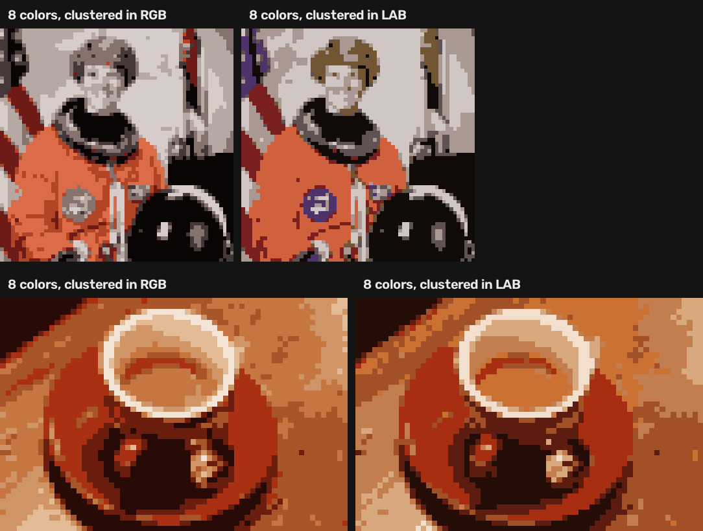
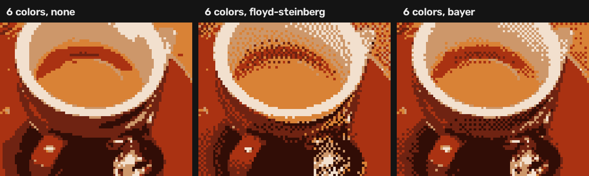
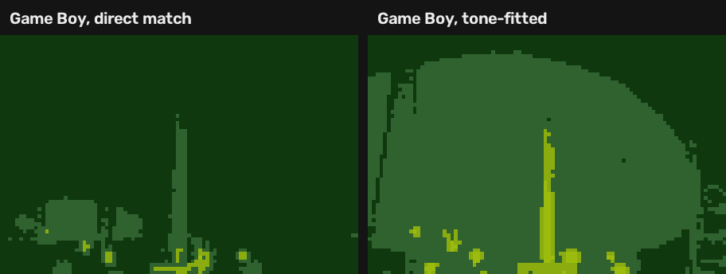

# Case study: pixel art, decided by measurement

**Goal:** turn any photo into convincing pixel art (few colors, big crisp pixels, optional
retro palettes and dithering) in the browser, with no upload.

**What changed since [project 01](../../01-document-scanner/docs/CASE-STUDY.md):** the
document scanner was tuned by looking at outputs. Here every design decision is backed by
a reproducible experiment ([`experiments/run.py`](../experiments/run.py) →
[RESULTS.md](RESULTS.md)) on a fixed set of public-domain images, averaged over images and
random seeds. The core algorithm, K-Means, is written from scratch and checked against
OpenCV's implementation instead of being called as a black box.

The experiments found **four problems that looking at a few outputs would have missed**.
Each one is below, with the numbers before and after.

---

## The pipeline

1. **Downscale** the photo to the target width with area averaging (each big pixel = the
   mean of the block it covers).
2. **Choose a palette:** learn *k* colors from the image with K-Means, or use a fixed retro
   palette (Game Boy, PICO-8, grayscale).
3. **Map** every pixel to a palette color, optionally with **dithering** (Floyd–Steinberg
   error diffusion or a Bayer pattern).
4. **Upscale** with nearest-neighbour so the pixels stay hard-edged.

## Measuring "looks right"

Pixel art is judged by eye, so the main metric is **ΔE in CIELAB**, a color space built so
that distance tracks perceived difference (ΔE ≈ 2.3 is a just-noticeable difference). For
dithering, which is meant to be seen from a distance, both images are also compared after
a Gaussian blur. For fixed palettes, where colors are deliberately wrong, the metric is
**structure**: the correlation between the photo's lightness and the result's.

---

## 1. RGB or CIELAB? The blue patch that disappeared

**Question.** K-Means groups colors by distance. In RGB, distance does not match
perception; in CIELAB it roughly does. Does that matter in practice?

**Measured** (mean ΔE, 4 images × 3 seeds):

| colors | RGB clustering | Lab clustering | |
|---|---|---|---|
| 4 | 10.66 | 9.68 | −9% |
| 8 | 7.21 | 6.57 | −9% |
| 16 | 5.17 | 4.60 | −11% |
| 32 | 3.70 | 3.36 | −9% |

A fair caveat: Lab clustering minimizes Lab distance by construction, so it is expected to
win on ΔE. The cross-check is the opposite metric: on plain RGB error, RGB clustering wins
by 9–19%. So the numbers alone say "trade-off", not "better".

**The picture settles it.** With 8 colors, RGB clustering spends its colors on the large,
similar areas (orange suit, grey background) and drops small saturated ones: the blue NASA
patch and the flag turn grey, and so does the hair. Lab clustering keeps them, because in
Lab a saturated blue is *far* from everything else, so it earns its own cluster.

**Decision:** cluster and match in CIELAB. The app keeps an RGB switch so visitors can see
the difference themselves.

## 2. My K-Means was 1–3% worse than OpenCV's

**Check.** Same data, same k-means++ seeding, same 20-iteration cap, compared by
*inertia* (mean squared distance to the assigned center, lower is better).

**Found.** The first version was consistently 1–3% worse than `cv2.kmeans`.

**Diagnosis.** Raising the iteration cap from 20 to 200 changed inertia by 0.15%, so it
was not convergence. The difference was the *seeding*. Plain k-means++ draws each new
center at random (weighted by distance). OpenCV, like scikit-learn, uses **greedy
k-means++**: it draws 2 + ln k candidates and keeps the one that lowers total distance the
most.

**Fixed:**

| colors | ours (after) | cv2.kmeans |
|---|---|---|
| 8 | 62.86 | 61.94 |
| 16 | 30.71 | 30.13 |
| 32 | **16.13** | 16.22 |

Within 2% everywhere, slightly better at 32 colors. It is ~15× slower (NumPy vs C++), which
item 4 makes irrelevant.

## 3. Bayer dithering made 16-color output worse

**Measured** (ΔE seen from a distance, blur σ = 1.5 px). Floyd–Steinberg helped at every
palette size. Bayer, with a fixed nudge of 48 RGB units, helped at 4 and 8 colors but at 16
colors scored **2.40 vs 2.38 without dithering**: worse than doing nothing.

**Diagnosis.** Bayer dithering adds a fixed threshold pattern to each pixel before picking
the nearest color. The nudge has to be about the size of the gap between neighbouring
palette colors: enough to tip a pixel over to the next color, not so much that it jumps
past it. With 16 colors the gaps are small, so a fixed 48 was far too strong and just added
noise.

**Fix.** Scale the nudge to the palette: the median distance from each palette color to its
nearest neighbour.

| colors | none | Floyd–Steinberg | Bayer (after fix) |
|---|---|---|---|
| 4 | 6.69 | 6.27 (−6%) | 6.20 (−7%) |
| 8 | 3.95 | 3.26 (−17%) | 3.69 (−7%) |
| 16 | 2.38 | 1.92 (−19%) | 2.26 (−5%) |

Both methods now help at every size. Up close (no blur), both are *worse* than no
dithering, which is expected: dithering trades per-pixel accuracy for the right average.

## 4. The Game Boy palette turned photos into green mush

**Symptom.** Mapped to the 4-color Game Boy palette, the rocket photo came out almost
entirely dark green; the rocket was barely visible.

**Diagnosis**, from the numbers rather than the picture:

- The photo is dark: median lightness 24 of 100. The palette spans lightness 20–72. Most
  pixels landed on the darkest entry.
- The palette is single-hue (all green). For a grey or blue pixel, the nearest green is
  decided by *hue* difference, which is about the same for every entry, not by lightness.

**Fix.**
1. **Tone fitting:** stretch the photo's lightness range (1st–99th percentile) onto the
   palette's range before matching.
2. For single-hue palettes, **match on lightness only**.

**Measured** (correlation between the photo's lightness and the result's; 1 = all light/dark
relations kept):

| palette | direct | tone-fitted | colors used (of palette) |
|---|---|---|---|
| Game Boy (4) | 0.69 | **0.87** | 3.2 → 4.0 |
| PICO-8 (16) | 0.84 | 0.90 | 8.2 → 8.5 |
| Grayscale (4) | 0.87 | 0.92 | 3.8 → 4.0 |

## 5. 4.7 seconds per click in the browser

The app runs the same Python in the browser through Pyodide (the setup reused from project
01). At the largest size (160 px) with Floyd–Steinberg, one update took **4.7 s** in
Chrome. Two causes, fixed in order of size:

**Floyd–Steinberg was a pixel-by-pixel Python loop** (25,600 iterations at 160×160). It
cannot be vectorized naively, because each pixel needs the errors of the pixels before it.
But pixel (y, x) only depends on (y, x−1) and the three pixels above it. So every pixel on
the skewed line **x + 2y = t** depends only on lines with smaller t, and a whole line can
be computed at once with NumPy. That is w + 2h steps (480) instead of w·h (25,600). Two
pixels of one line can push error onto the same neighbour, so the update uses
`np.add.at`, which accumulates both. The output is **identical, pixel for pixel**, to the
textbook loop; the tests compare the two.

| size | textbook loop | wavefront | speed-up |
|---|---|---|---|
| 64×64 | 75 ms | 15 ms | 5× |
| 96×96 | 175 ms | 24 ms | 7× |
| 160×160 | 484 ms | 45 ms | 11× |

**K-Means ran on every pixel.** A palette summarizes the color distribution, and a random
sample describes a distribution as well as the full set. Learning from a fixed-seed sample
of 4,096 pixels gave the same ΔE within ±2% (sometimes better) and was 5–8× faster at
160 px.

**Result in the browser: 4.7 s → 2.0 s → 0.33 s.**

---

## Takeaways

- **A metric can be rigged by construction.** Lab clustering "winning" on Lab distance
  proves little; the opposite metric and a picture made the case.
- **Comparing against a reference implementation finds bugs that tests don't.** The
  K-Means was correct; it was just worse, and only the comparison showed it.
- **Parameters tuned for one case break in another.** The Bayer strength worked at 4
  colors and failed at 16; the fix was to derive it from the data.
- **Measure before optimizing, then change one thing at a time.** The first fix
  (wavefronts) halved the time; only then did K-Means show up as the next bottleneck.
- **Every claim here can be re-run:** `python -m experiments.run` regenerates all tables.
