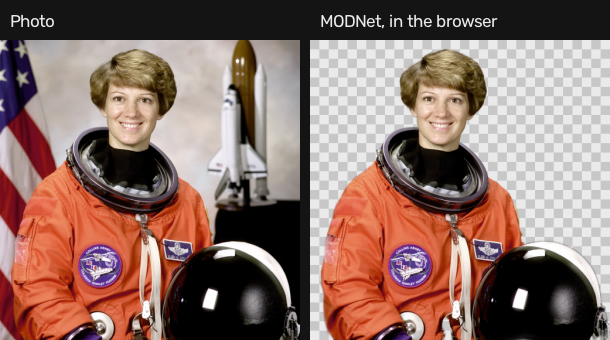
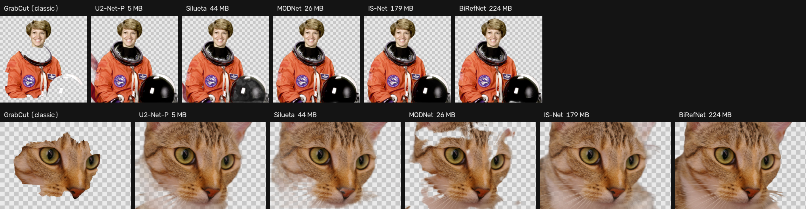
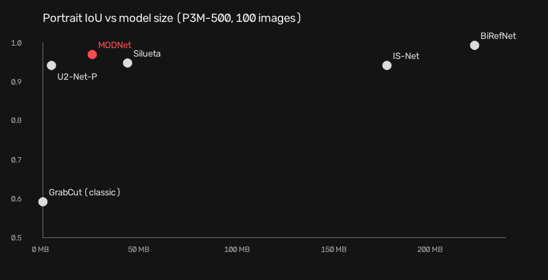

<div align="center">

# حذف پس‌زمینه · Background Remover

**پس‌زمینه‌ی عکس را با یادگیری عمیق حذف می‌کند، کاملاً داخل مرورگر**
۵ شبکه‌ی عصبی و یک روش کلاسیک، سنجیده‌شده روی دو دیتاست استاندارد

[](https://github.com/Milad1098/image-processing-projects/actions/workflows/tests.yml)


[](../LICENSE)

[English](#english) · [Case study](docs/CASE-STUDY.md) · [Results](docs/RESULTS.md)



</div>

<div dir="rtl">

## امکانات

- **دو حالت:** «آدم» با مدل پرتره‌ی MODNet (حتی مو) و «شیء» با مدل عمومی سبک U²-Net-P
- **پس‌زمینه‌ی جدید:** شفاف، سفید، رنگ دلخواه، یا محو (مثل حالت پرتره‌ی گوشی)
- **خروجی PNG** با کانال شفافیت
- **بدون آپلود:** مدل روی دستگاه خود کاربر اجرا می‌شود
- **فقط یک بار دانلود:** مدل در حافظه‌ی مرورگر ذخیره می‌شود
- **فارسی و انگلیسی**، سازگار با موبایل

## چه چیزی نسبت به پروژه‌های قبل پیشرفت کرده

[پروژه‌ی ۱](../01-document-scanner/) بینایی ماشین کلاسیک بود که با چشم تنظیم شد؛ [پروژه‌ی ۲](../02-pixel-art/) هر تصمیم را با آزمایش روی چند تصویر گرفت. این پروژه **اولین کار با یادگیری عمیق** است و **اولین ارزیابی روی دیتاست‌های استاندارد با جواب درست**: پنج شبکه‌ی عصبی و یک روش کلاسیک، با سه معیار دقت، روی دو نوع عکس، و با سنجش سرعت در شرایط واقعی گوشی. نتیجه‌ی اصلی: «بهترین مدل» به نوع عکس و دستگاه کاربر بستگی دارد. جزئیات در [**Case study**](docs/CASE-STUDY.md).

</div>

---

<a name="english"></a>
## English

Removes the background from a photo in the browser with a neural network. No upload: ONNX
Runtime Web runs the model on the visitor's device.

**The point of this project is choosing a model with evidence.** Five open-licensed networks
(5–224 MB) and a classic baseline were benchmarked on two public test sets with ground truth,
with three accuracy metrics and speed measured on one thread, as a browser would run them.

### Key findings

| Question | Finding |
|---|---|
| How much does deep learning add? | The smallest network (5 MB) roughly doubles GrabCut's object IoU (0.39 → 0.74) and is 17× faster |
| Which model is best? | It depends on the photo: IS-Net leads on objects (0.94), BiRefNet on portraits (0.99); the portrait specialist MODNet scores 0.97 on people and 0.27 on objects |
| Can the best model run in a browser? | Not on a phone: BiRefNet takes 15 s per image on one thread and is a 224 MB download. MODNet: 0.6 s, 26 MB |
| Does the JavaScript port match the benchmark? | Yes: IoU 0.9993–1.0000 against the Python reference |

<p align="center"></p>

<p align="center"></p>

**Read more:** [Case study](docs/CASE-STUDY.md) · [All results](docs/RESULTS.md) · [Architecture](docs/ARCHITECTURE.md) · [Design decisions](docs/DECISIONS.md) · [Roadmap](docs/ROADMAP.md) · [Model licenses](models/README.md)

### Project structure

```
bgremove/          reference pipeline in Python
  models.py        one ModelSpec per network; predict(name, rgb) -> alpha matte
  classic.py       GrabCut baseline
  metrics.py       IoU, MAE, Boundary F
  compose.py       transparent cutout, background replacement
experiments/
  download.py      models + test sets (not committed)
  run.py           accuracy benchmark -> docs/RESULTS.md (resumable, per-image cache)
  speed.py         clean speed benchmark (warm-up, minimum of repeated runs)
web/               browser app: ONNX Runtime Web, no server-side processing
tests/             metric values, pre/post-processing per model, GrabCut, composition
docs/              case study, results, architecture, decisions, figures
```

### Run locally

Requires Python 3.10+.

```bash
python -m venv .venv
.venv\Scripts\activate             # macOS/Linux: source .venv/bin/activate
pip install -r requirements-dev.txt

python -m http.server 8000         # browser app: http://localhost:8000/web/  (?lang=fa)
python -m tests.test_bgremove      # self-check (no downloads needed)

python -m experiments.download     # ~1 GB: models + test sets
python -m experiments.run          # accuracy benchmark (~45 min on CPU, resumable)
python -m experiments.speed        # speed benchmark
python docs/make_figures.py        # regenerate the figures
```

The browser app fetches its models from Hugging Face on first use, so it works without
`experiments.download`.

### Known limits

- Object mode uses a 5 MB model (IoU 0.74 on objects); the accurate general models are too
  large for a phone browser today.
- One thread in the browser: ~1.3–1.5 s per photo on a laptop, slower on phones.
- 100 images per test set; differences of ±0.01 IoU between close models are within noise.

## License

Code: [MIT](../LICENSE) © Milad Mobaseri. Model weights belong to their authors
([licenses](models/README.md)).
